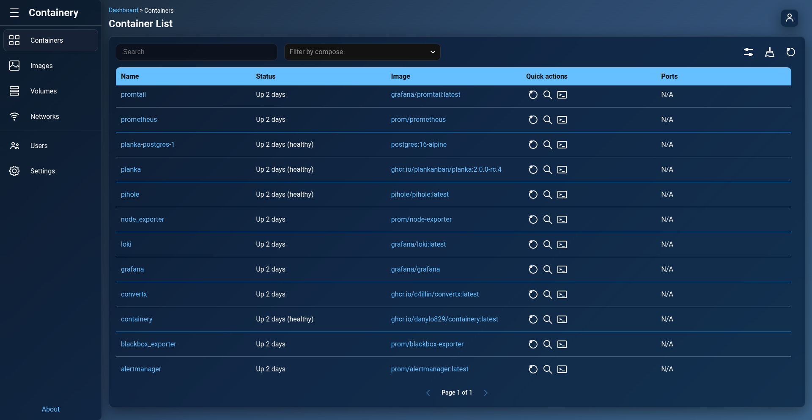

# Container Management

Manage container lifecycles, inspect container details, view real-time logs, examine running processes, open interactive web terminals, and customize table layouts across all Docker hosts.

---

## 1. Container List & Filtering

* **Navigation**: **Containers** (Sidebar: **Containers**).

### Features

* **Multi-Host Aggregation**: Displays all containers running across your connected Docker hosts in a single unified table.
* **Filter by Docker Host**: Use the top host filter bar to toggle specific Docker hosts on or off.
* **Filter by Docker Compose Project**: Select specific Docker Compose projects from the dropdown filter, or select **standalone** to show containers created individually without Docker Compose.
* **Search, Sorting & Pagination**: Search containers by container name, container ID, image, state, or status. Click column headers to sort ascending or descending.

---

## 2. Customizing Table View & Quick Actions

* **Navigation**: **Containers** > **Click Table Settings icon** (or **List Settings** button).

Customize table columns and quick action shortcuts to suit your workflow:

* **Visible Columns**: Toggle checkboxes for:
  * Name
  * Status (e.g. *Up 3 hours*, *Exited (0)*)
  * Image
  * Quick actions
  * Ports
  * Created
  * State
* **Quick Actions Shortcuts**: Customize which action buttons appear directly inside each container row:
  * **Start** / **Stop** / **Restart** / **Delete**
  * **Processes** / **Logs** / **Terminal**
* Click **Save Settings** to persist your layout into your personal account settings.

---

## 3. Container Lifecycle Controls & Bulk Pruning

### Container Actions

* **Start Container**: **Containers** > **Click Start icon** next to a stopped container.
* **Stop Container**: **Containers** > **Click Stop icon** next to a running container.
* **Restart Container**: **Containers** > **Click Restart icon** to restart a container.
* **Delete Container**: **Containers** > **Click Delete icon** to permanently delete a container.

### Bulk Pruning Unused Containers

* **Navigation**: **Containers** > **Click Prune Containers button**.
* **Action**: Deletes all stopped containers across selected Docker hosts and reports the total reclaimed disk space.

---

## 4. Container Details Inspection

* **Navigation**: **Containers** > **Click Container Name**.

View comprehensive container metadata:

* **General Info**: Full Container ID, Created timestamp, State, Status, Image ID, Command, Entrypoint.
* **Network & Ports**: Port bindings (with direct clickable HTTP links to published host ports), assigned IPv4/IPv6 addresses, MAC address, gateway, and connected Docker networks.
* **Mounts & Volumes**: Source host paths, destination container paths, mode (`rw` / `ro`), and volume driver types.
* **Environment & Labels**: Environment variables (`KEY=VALUE`) and Docker labels.

---

## 5. Real-Time Logs

* **Navigation**: **Containers** > **Click Container Name** > **Logs** (or click **Logs** quick action icon).

### Options

* **Tail Lines**: Enter the number of recent log lines to fetch (e.g. 100, 500 lines).
* **Stream Selection**: Filter output by `all`, `stdout`, or `stderr`.
* **Output Window**: Formatted log viewer with auto-scroll and dark background.

---

## 6. Running Container Processes (`top`)

* **Navigation**: **Containers** > **Click Container Name** > **Processes** (or click **Processes** quick action icon).

Inspect live active processes running inside the container:

* **Process Attributes**: PID, User, CPU percentage, Memory usage, Virtual Memory size, TTY, Status, and Command line.

---

## 7. Interactive Web Terminal (Exec)

* **Navigation**: **Containers** > **Click Container Name** > **Terminal** (or click **Terminal** quick action icon).

Open a direct interactive shell inside the container:

* **WebSocket Streaming**: Powered by SocketIO and xterm-compatible terminal rendering.
* **Automatic Shell Detection**: Attempts to spawn `/bin/bash` or `/bin/sh`.
* **Interactive Troubleshooting**: Run CLI commands, inspect files, or debug applications directly in your browser window.
