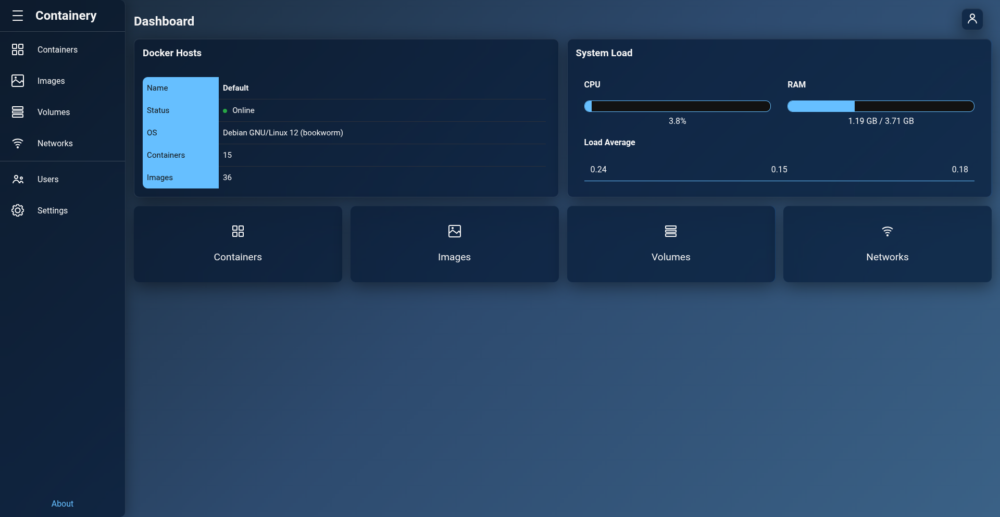

# Dashboard & Host Overview

The **Dashboard** serves as your central command center in Containery, aggregating real-time status indicators, system metrics, and disk space statistics across all connected Docker hosts.

---

## 1. Dashboard Overview Cards

* **Navigation**: **Dashboard** (click the **Containery** logo in the top-left sidebar or home icon).

### Overview Features

* **Multi-Host Aggregation**: Displays separate status cards for every enabled Docker host configured in Containery.
* **Host Status Indicators**:
    * **Online**: The Docker daemon is connected and responding normally over the Unix socket or remote proxy endpoint.
    * **Offline**: The target host is unreachable, offline, or timed out. Displays the connection error details.
* **Summary Metrics**: Displays the total count of running containers, stopped containers, stored images, Docker Engine version, OS kernel, and CPU architecture.
* **Update Notification Banner**: Automatically checks GitHub for new Containery releases and displays a banner when a newer version is available.

---

## 2. Deep-Dive Host System Statistics

* **Navigation**: **Dashboard** > **Click Host Card / Info**.

This view fetches detailed system telemetry (`docker info`) and storage usage (`docker df`) for the selected Docker host.

### Docker System Info (`docker info`)

* **Engine Details**: Docker Server Version, Storage Driver (e.g. `overlay2`), Logging Driver, Cgroup Driver, Cgroup Version (`v1` / `v2`).
* **Hardware & Limits**: Total Memory, CPUs, Memory Limit support, Swap Limit support, OOM Kill Disable support.
* **Security & Features**: Security Options (e.g. `apparmor`, `seccomp`), Rootless Mode status, Experimental features flag.

### Storage & Disk Usage Breakdown (`docker df`)

View exact disk space usage categorized into four main components:

1. **Containers**: Total disk space consumed by writable container layers (diff size), total container count, and active running containers count.

2. **Images**: Disk space consumed by stored Docker images, total image count, and active images in use by containers.

3. **Local Volumes**: Disk space consumed by local Docker volumes, total volume count, and mounted volumes in use.

4. **Build Cache**: Reclaimable disk space consumed by Docker build cache objects.
