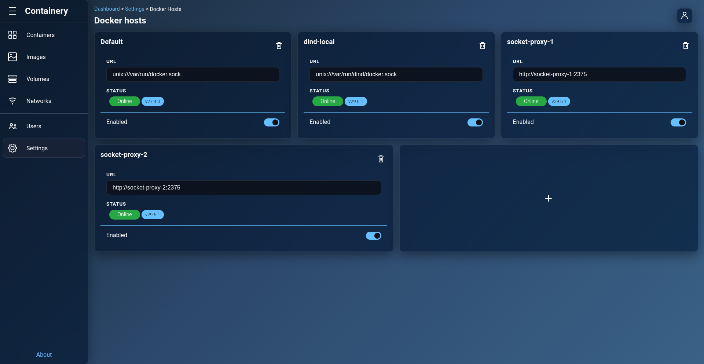
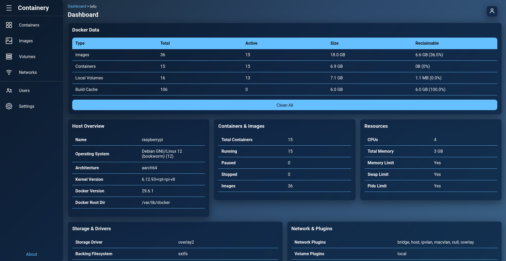
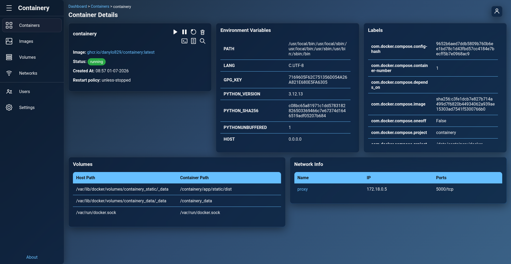
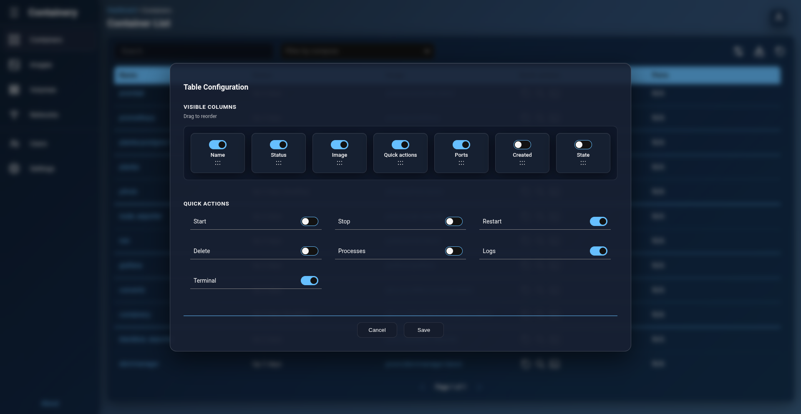
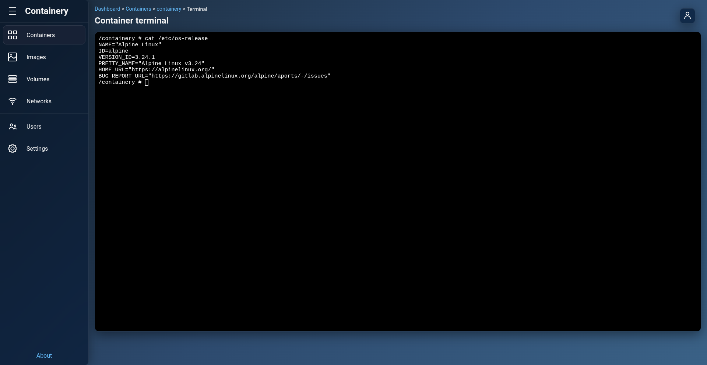
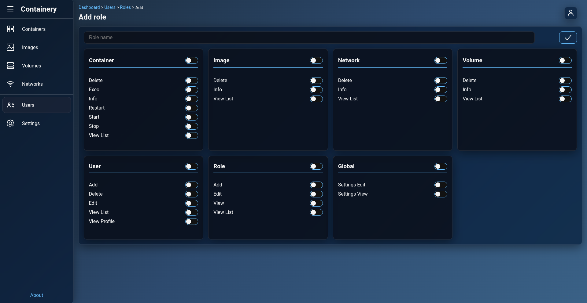
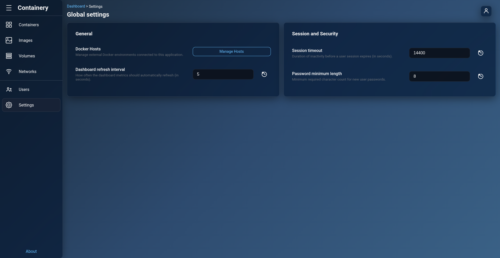

# Usage Guide

This guide explains how to use Containery to manage your Docker hosts, containers, images, and users.

---

## Adding a Docker Host

Containery allows you to monitor and manage multiple Docker hosts from a single dashboard.

### Local Unix Socket
If you are running Containery on the same machine as your Docker daemon (or sharing the socket via a Docker volume), you can use the Unix socket.

**URL**: `unix:///var/run/docker.sock`

### Remote Host via Socket Proxy (Recommended)
For remote machines, we highly recommend running a secure socket proxy on the target host (e.g., [linuxserver/socket-proxy](https://github.com/linuxserver/docker-socket-proxy)). This exposes the Docker socket over HTTP/HTTPS and lets you restrict which operations are allowed.

For example, if you want Containery to only have read-only access to browse images, you can enable `IMAGES` and `INFO` but keep all writing permissions disabled.

**URL**: `http://<remote-host>:<proxy-port>`

To add a host, navigate to **Settings → Docker Hosts → Add** in the web interface and enter the connection details.

### Docker Hosts Settings

### Docker Host Overview

---

## Containers & Terminal

Once a host is selected, you can view its running and stopped containers.

### Container Details
*   **Logs**: Stream container logs in real-time.
*   **Terminal**: Open a direct shell terminal into any running container to troubleshoot and run commands.
*   **Actions**: Start, stop, restart, and delete containers directly.

### Container Overview

### Container List Settings

### Interactive Terminal Preview

---

## User Management & Access Control

Containery comes with role-based access control (RBAC) to ensure different team members have the appropriate permissions.

*   **Create Roles**: Define roles with specific permissions (e.g., read-only, admin, developer).
*   **Assign Roles**: Assign roles to users on user creation or editing.
*   **Manage Permissions**: Selectively enable access to specific hosts, containers, or destructive commands (like deleting images or stopping containers).

### Role Management Preview

---

## Application Settings

The settings panel allows you to configure application-wide preferences, docker hosts, roles, and other general configuration options.

### General Settings Panel

